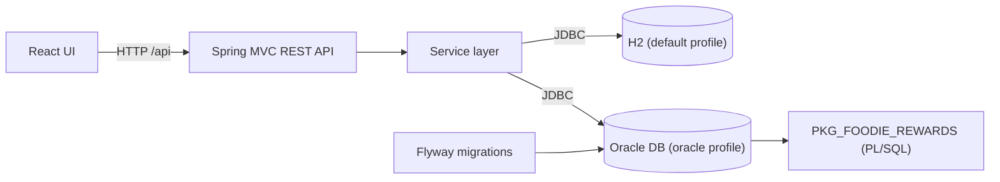

# 🍽️ FoodieReward

A full-stack **points and rewards management application** built for the Group G37 project. FoodieReward manages customer memberships, point balances, reward inventory, redemptions, and transaction records. Every action in the interface is handled by a Java backend and persisted in a relational database, which can be either **H2** (zero-setup local development) or **Oracle Database** with business logic in a **PL/SQL package**.

---

## Table of Contents

- [Features](#features)
- [Technology Stack](#technology-stack)
- [Architecture](#architecture)
- [Quick Start (H2)](#quick-start-h2)
- [Run with Oracle Database](#run-with-oracle-database)
- [REST API](#rest-api)
- [Testing](#testing)
- [Project Layout](#project-layout)
- [Resetting Demo Data](#resetting-demo-data)
- [Troubleshooting](#troubleshooting)
- [Further Reading](#further-reading)

---

## Features

- **Browse records:** customers, memberships, points, rewards, redemptions, and transactions.
- **Earn points** from a purchase amount.
- **Manage statuses** for memberships and redemptions.
- **Redeem rewards** and **restock** reward inventory.
- **Complete transactions** and **remove failed transactions**.
- **Persistent storage:** changes survive application restarts.
- **Two database modes:** H2 for local development, Oracle with PL/SQL for a production-style setup.

## Technology Stack

| Layer | Technology |
| --- | --- |
| Language / Runtime | Java 17 |
| Backend framework | Spring Boot 4, Spring MVC (REST), JDBC |
| Local database | H2 (file-based, Oracle compatibility mode) |
| Production-style database | Oracle Database, Oracle JDBC, `PKG_FOODIE_REWARDS` PL/SQL package |
| Schema migrations | Flyway (Oracle profile) |
| Frontend | React, served by Spring Boot |
| Build tool | Maven (Maven Wrapper included) |

> **Note:** The interface loads React, ReactDOM, Babel, and fonts from external CDNs. An internet connection is required when loading the page unless these assets are made local.

## Architecture



| | H2 (default) | Oracle (`oracle` profile) |
| --- | --- | --- |
| Setup | None | Requires an Oracle instance and schema user |
| Schema management | Schema and seed data created automatically | Flyway migrations `V1`–`V3` |
| Business logic | Java service layer | Java layer calling `PKG_FOODIE_REWARDS` |
| Best for | Development and demos | Testing PL/SQL and Oracle behaviour |

---

## Quick Start (H2)

**Requirements:** Java 17 or later. No separate database installation is needed.

From the G37 project root:

```powershell
cd .\foodie-reward
.\mvnw.cmd spring-boot:run
```

Then open **<http://localhost:8081>**.

> **macOS / Linux:** use `./mvnw spring-boot:run` instead.

> ⚠️ Run the app with the Maven command above. The VS Code **Run Code** button does not include Spring Boot's dependencies and will fail.

The default H2 database is file-based and stored under `foodie-reward/data`, so records persist across restarts.

### H2 Console

With the app running, open <http://localhost:8081/h2-console> and connect with:

| Setting | Value |
| --- | --- |
| Driver Class | `org.h2.Driver` |
| JDBC URL | `jdbc:h2:file:./data/foodie-reward;MODE=Oracle;DATABASE_TO_LOWER=TRUE;DEFAULT_NULL_ORDERING=HIGH` |
| User Name | `sa` |
| Password | *(leave blank)* |

The H2 Console is for local development only. SQL changes made there affect the local H2 database only. To use SQL\*Plus, run the app in Oracle mode instead.

---

## Run with Oracle Database

### 1. Prepare the database

Start an Oracle Database instance and create an application schema/user with permission to create **tables, indexes, and PL/SQL packages**.

### 2. Configure the connection

From PowerShell in `foodie-reward`, set the connection details for the current terminal session:

```powershell
$env:FOODIE_DB_URL      = "jdbc:oracle:thin:@localhost:1521/FREEPDB1"
$env:FOODIE_DB_USERNAME = "foodie_app"
$env:FOODIE_DB_PASSWORD = "your-password"
```

| Variable | Description | Example |
| --- | --- | --- |
| `FOODIE_DB_URL` | JDBC URL of the Oracle service | `jdbc:oracle:thin:@localhost:1521/FREEPDB1` |
| `FOODIE_DB_USERNAME` | Application schema user | `foodie_app` |
| `FOODIE_DB_PASSWORD` | Password for that user | *(your own)* |

> 🔒 Never commit real credentials. Keep them in environment variables or an untracked local config file.

### 3. Start with the Oracle profile

```powershell
.\mvnw.cmd spring-boot:run "-Dspring-boot.run.profiles=oracle"
```

### 4. Flyway migrations

Flyway applies these migrations on first launch:

| Order | File | Purpose |
| --- | --- | --- |
| 1 | `V1__create_foodie_schema.sql` | Creates tables and indexes |
| 2 | `V2__create_foodie_plsql_package.sql` | Creates the `PKG_FOODIE_REWARDS` package |
| 3 | `V3__seed_foodie_demo_data.sql` | Inserts demonstration records |

All files live in `src/main/resources/db/migration/oracle/`.

Later launches apply only **new** migrations. To change the schema or add seed data, create a new versioned file such as `V4__add_demo_records.sql`. **Do not edit a migration that has already been applied**, as Flyway will reject the changed checksum.

SQL\*Plus can connect to the same Oracle service and schema to inspect or add data.

---

## REST API

The UI communicates with the Spring Boot backend under `/api`.

| Method | Endpoint | Purpose |
| --- | --- | --- |
| `GET` | `/api/state` | Load customers, memberships, points, rewards, redemptions, and transactions |
| `POST` | `/api/members/{customerId}/earn` | Add points from a purchase amount |
| `PATCH` | `/api/memberships/{membershipId}` | Update membership status |
| `POST` | `/api/rewards/{rewardId}/redeem` | Redeem a reward for a customer |
| `POST` | `/api/rewards/{rewardId}/restock` | Increase reward stock |
| `PATCH` | `/api/redemptions/{redemptionId}` | Process a redemption status |
| `PATCH` | `/api/transactions/{transactionId}/complete` | Complete a transaction |
| `DELETE` | `/api/transactions/failed` | Delete failed transactions |

Quick check that the API is running:

```powershell
curl http://localhost:8081/api/state
```

---

## Testing

From the `foodie-reward` directory:

```powershell
.\mvnw.cmd test
```

## Project Layout

```text
G37/
├── README.md
└── foodie-reward/
    ├── src/main/java/com/foodie/reward/         # API, services, and app entry point
    ├── src/main/resources/                      # H2 config, schema, and interface
    │   └── db/migration/oracle/                 # Oracle schema, package, and seed migrations
    ├── src/test/                                # Automated tests
    └── data/                                    # Persistent local H2 database files
```

## Resetting Demo Data

1. Stop the application.
2. Delete the `foodie-reward/data` folder.
3. Start the app again. The schema and demo records are recreated.

This removes local H2 data only; **Oracle data is not affected**.

---

## Troubleshooting

| Problem | Likely cause and fix |
| --- | --- |
| App fails with missing Spring classes when using **Run Code** | Use `.\mvnw.cmd spring-boot:run` instead. |
| Port `8081` already in use | Stop the other process using that port, or change the server port in the application configuration. |
| UI loads blank or unstyled | The page needs internet access for the React, Babel, and font CDNs. |
| H2 Console cannot connect | Make sure the JDBC URL matches the table above exactly and the app is running. |
| Oracle connection refused | Check that the instance is up and that `FOODIE_DB_URL` uses the correct host, port, and service name. |
| Flyway checksum / validation error | An applied migration was edited. Revert it and put the change in a new `V<n>__*.sql` file. |
| Oracle variables ignored | Environment variables apply only to the current terminal session; set them again in each new session. |

## Further Reading

- Database configuration details: [`foodie-reward/DATABASE_SETUP.md`](foodie-reward/DATABASE_SETUP.md)

---

## Team

Group G37. 
*OWI WILSON
*NG WEI JIE
*TAN CHENG LOCK
*YEE HAO ZHE

## License
For CourseWork Purposes Only
