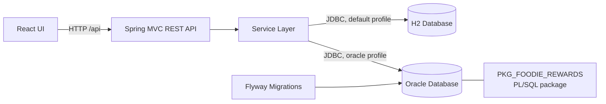

<div align="center">

# 🍽️ FoodieReward

### A Full-Stack Points & Rewards Management App

A Spring Boot and React application that manages customer **memberships, point balances, reward inventory, redemptions, and transactions**, backed by either **H2** for local development or **Oracle Database with PL/SQL**.


[Features](#-features) · 


</div>

---

## 📖 Table of Contents

- [About the Project](#-about-the-project)
- [Features](#-features)
- [Screenshots](#-screenshots)
- [Technology Stack](#-technology-stack)
- [Architecture](#-architecture)
  - [High-Level Overview](#high-level-overview)
  - [Database Modes](#database-modes)
- [Project Structure](#-project-structure)
- [Getting Started](#-getting-started)
  - [Prerequisites](#prerequisites)
  - [Run Locally with H2](#1-run-locally-with-h2)
  - [Run with Oracle Database](#2-run-with-oracle-database)
- [REST API](#-rest-api)
- [Testing](#-testing)
- [Resetting Demo Data](#-resetting-demo-data)
- [Security Notes](#-security-notes)
- [Troubleshooting](#-troubleshooting)
- [Known Limitations](#-known-limitations)
- [Roadmap](#-roadmap)
- [Team](#-team)

---

## 🎯 About the Project

**FoodieReward** is a points and rewards management application based on the **Group G37** project interface. Every action in the UI is handled by a Java backend and stored in a relational database, so changes persist across restarts.

The project combines:

- **Customer loyalty management**: memberships, point balances, and transaction history
- **Reward operations**: inventory, restocking, and redemption processing
- **Flexible persistence**: zero-setup H2 for development, Oracle Database for a production-style setup
- **Database-side logic**: business operations exposed through the `PKG_FOODIE_REWARDS` PL/SQL package
- **Versioned schema**: Flyway migrations for repeatable Oracle deployments

> This project was developed as part of **Group G37** coursework.

---

## ✨ Features

### 👥 Customers & Memberships
- View customer, membership, and point records
- **Earn points** from a purchase amount
- **Change membership status**

### 🎁 Rewards & Redemptions
- View reward inventory and redemption records
- **Redeem rewards** for a customer
- **Restock** reward inventory
- **Process redemption statuses**

### 💳 Transactions
- View transaction records
- **Complete** transactions
- **Remove failed** transactions

### 🗄 Data & Persistence
- Changes are stored in a **persistent local database**
- Run with **H2** (local development) or **Oracle Database with PL/SQL**
- Oracle schema managed through **Flyway migrations**

---

## 📸 Screenshots

<!-- Replace the placeholders below with real screenshots / GIFs.
     Suggested folder: docs/screenshots/ -->

| Dashboard | Rewards | Redemptions |
| :---: | :---: | :---: |
|  |  |  |

| Memberships | Transactions | H2 Console |
| :---: | :---: | :---: |
|  |  |  |

🎥 **Demo video:** _add your YouTube / Drive link here_

---

## 🛠 Technology Stack

| Area | Technologies |
| --- | --- |
| Language / Runtime | Java 17 |
| Backend Framework | Spring Boot 4 |
| API | Spring MVC REST |
| Data Access | JDBC |
| Local Database | H2 (file-based, Oracle compatibility mode) |
| Production-style Database | Oracle Database, Oracle JDBC |
| Database Logic | `PKG_FOODIE_REWARDS` PL/SQL package |
| Schema Migrations | Flyway (Oracle profile) |
| Frontend | React, served by Spring Boot |
| Build Tool | Maven (Maven Wrapper included) |

> **Note:** The interface loads React, ReactDOM, Babel, and fonts from external CDNs, so an internet connection is needed when loading the page unless those assets are made local.

---

## 🏗 Architecture

### High-Level Overview



### Database Modes

| | H2 (default) | Oracle (`oracle` profile) |
| --- | --- | --- |
| Setup | None | Requires an Oracle instance and a schema user |
| Schema management | Schema and demo data created automatically | Flyway migrations `V1`–`V3` |
| Storage | File-based under `foodie-reward/data` | Oracle service |
| Best for | Development and demos | PL/SQL and Oracle behaviour |

---

## 📂 Project Structure

```text
G37/
├── README.md
└── foodie-reward/
    ├── src/main/java/com/foodie/reward/         API, services, and app entry point
    ├── src/main/resources/                      H2 config, schema, and interface
    │   └── db/migration/oracle/                 Oracle schema, package, and seed migrations
    ├── src/test/                                Automated tests
    └── data/                                    Persistent local H2 database files
```

---

## 🚀 Getting Started

### Prerequisites

| Requirement | Version / Notes |
| --- | --- |
| Java | **17 or later** |
| Maven | Not needed separately (Maven Wrapper `mvnw` is included) |
| Internet connection | Needed to load React, Babel, and fonts from CDNs |
| Oracle Database | Optional, only for Oracle mode (needs a user that can create tables, indexes, and PL/SQL packages) |

### 1. Run Locally with H2

No separate database installation is needed.

Open PowerShell at the G37 project root:

```powershell
cd .\foodie-reward
.\mvnw.cmd spring-boot:run
```

> **macOS / Linux:** use `./mvnw spring-boot:run` instead.

Open <http://localhost:8081>.

> ⚠️ Use the Maven command to run the app. The VS Code **Run Code** button does not include Spring Boot's dependencies.

The default H2 database is file-based and stored under `foodie-reward/data`. Its records persist when the application stops and starts.

#### Open the H2 Console

With the app running, open <http://localhost:8081/h2-console> and connect with:

| Setting | Value |
| --- | --- |
| Driver Class | `org.h2.Driver` |
| JDBC URL | `jdbc:h2:file:./data/foodie-reward;MODE=Oracle;DATABASE_TO_LOWER=TRUE;DEFAULT_NULL_ORDERING=HIGH` |
| User Name | `sa` |
| Password | _(leave blank)_ |

The H2 Console is for local development. SQL changes made there affect the local H2 database only. To use SQL\*Plus, run the app in Oracle mode.

### 2. Run with Oracle Database

**Step 1: Prepare the database.** Start an Oracle Database instance and create an application schema/user with permission to create tables, indexes, and PL/SQL packages.

**Step 2: Configure the connection.** From PowerShell in `foodie-reward`, set the details for the current terminal session:

```powershell
$env:FOODIE_DB_URL = "jdbc:oracle:thin:@localhost:1521/FREEPDB1"
$env:FOODIE_DB_USERNAME = "foodie_app"
$env:FOODIE_DB_PASSWORD = "your-password"
```

| Variable | Description |
| --- | --- |
| `FOODIE_DB_URL` | JDBC URL of the Oracle service |
| `FOODIE_DB_USERNAME` | Application schema user |
| `FOODIE_DB_PASSWORD` | Password for that user |

**Step 3: Start with the Oracle profile.**

```powershell
.\mvnw.cmd spring-boot:run "-Dspring-boot.run.profiles=oracle"
```

**Step 4: Flyway applies migrations on first launch.**

| Order | File | Purpose |
| --- | --- | --- |
| 1 | `V1__create_foodie_schema.sql` | Creates tables and indexes |
| 2 | `V2__create_foodie_plsql_package.sql` | Creates the `PKG_FOODIE_REWARDS` package |
| 3 | `V3__seed_foodie_demo_data.sql` | Inserts demonstration records |

All files are in `src/main/resources/db/migration/oracle/`.

Later launches apply only new migrations. To add schema or seed changes, create a new versioned migration such as `V4__add_demo_records.sql`. **Do not edit a migration that has already been applied.**

SQL\*Plus can connect to the same Oracle service and schema to inspect or add data.

For more configuration details, see [`foodie-reward/DATABASE_SETUP.md`](foodie-reward/DATABASE_SETUP.md).

---

## 🔌 REST API

The UI communicates with the Spring Boot backend under `/api`.

| Method | Endpoint | Purpose |
| --- | --- | --- |
| `GET` | `/api/state` | Load customers, memberships, points, rewards, redemptions, and transactions |
| `POST` | `/api/members/{customerId}/earn` | Add points from a purchase amount |
| `PATCH` | `/api/memberships/{membershipId}` | Update membership status |
| `POST` | `/api/rewards/{rewardId}/redeem` | Redeem a reward for a customer |
| `POST` | `/api/rewards/{rewardId}/restock` | Increase reward stock |
| `PATCH` | `/api/redemptions/{redemptionId}` | Process a redemption status |
| `PATCH` | `/api/transactions/{transactionId}/complete` | Complete a transaction |
| `DELETE` | `/api/transactions/failed` | Delete failed transactions |

Quick check that the API is running:

```powershell
curl http://localhost:8081/api/state
```

---

## 🧪 Testing

From the `foodie-reward` directory:

```powershell
.\mvnw.cmd test
```

---

## ♻️ Resetting Demo Data

1. Stop the application.
2. Delete the `foodie-reward/data` folder.
3. Start the app again. The schema is recreated and the demonstration records are seeded.

This deletes local H2 data stored in that folder. It does **not** affect Oracle data.

---

## 🔐 Security Notes

- Never commit real database credentials. Set `FOODIE_DB_*` variables in your terminal session only.
- Use a dedicated application schema user for Oracle, not an admin account.
- The H2 Console is intended for **local development only**.

---

## 🩺 Troubleshooting

| Problem | Likely Cause | Fix |
| --- | --- | --- |
| Missing Spring classes when using **Run Code** | VS Code runner skips Spring Boot dependencies | Run `.\mvnw.cmd spring-boot:run` |
| Port `8081` already in use | Another process is using it | Stop that process, or change the server port in the app configuration |
| UI loads blank or unstyled | CDN assets (React, Babel, fonts) could not load | Check your internet connection |
| H2 Console cannot connect | JDBC URL mismatch or app not running | Use the exact URL from the table above and start the app first |
| Oracle connection refused | Wrong host, port, or service name, or instance not running | Verify `FOODIE_DB_URL` and that the Oracle service is up |
| Flyway checksum / validation error | An applied migration was edited | Revert it and add the change as a new `V<n>__*.sql` file |
| Oracle settings seem ignored | Variables were set in a different terminal session | Set them again in the terminal that runs the app |

---

## ⚠️ Known Limitations

- The UI needs internet access for CDN-hosted assets unless they are made local.
- The H2 Console and file-based H2 database are for local development only.
- Oracle seed data is applied through versioned migrations, so changes need a new migration file.

---

## 🗺 Roadmap

- [ ] Bundle React, Babel, and fonts locally for offline use
- [ ] Add more reward and membership reporting views
- [ ] Add authentication and role-based access

_(Edit this list to reflect your actual plans.)_

---

## 👤 Team

**Group G37**

| Name | Role |
| --- | --- |
| _Add member name_ | _Add role_ |

<!-- Add GitHub / LinkedIn links here -->

---

<div align="center">

⭐ If you find this project interesting, consider giving it a star!

</div>
